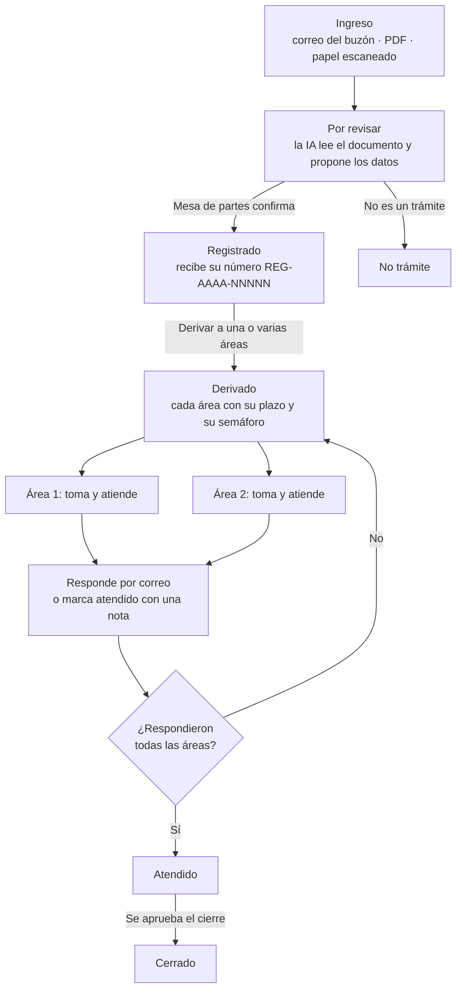
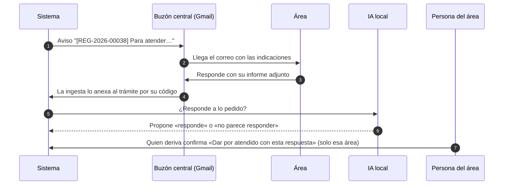
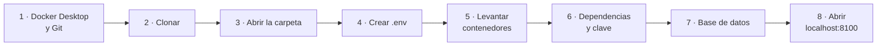
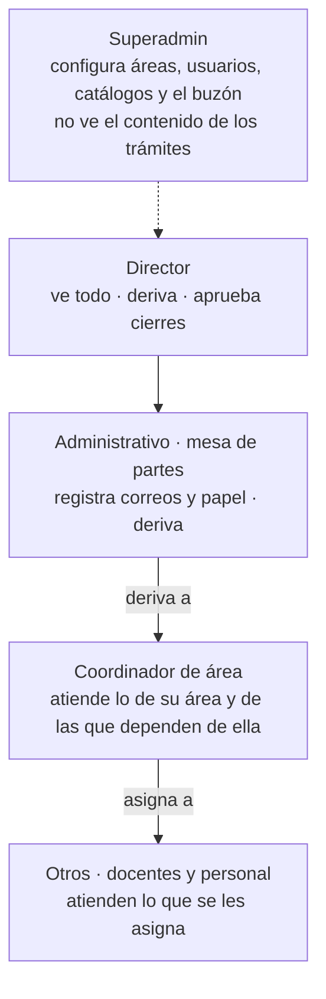
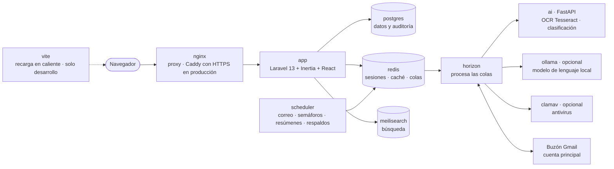

<p align="center">
  
</p>

<h1 align="center">Trámite Documentario</h1>

<p align="center">
  Expedientes, plazos y semáforos para una filial universitaria, con IA que corre en el propio servidor.
</p>

<p align="center">
  
  
  
  
  
  
  <br>
  
  
  
  
  
  
  
</p>

---

**Contenido:** [Propósito](#propósito) · [Guía rápida para alumnos](#guía-rápida-para-alumnos-windows) · [Requisitos previos](#requisitos-previos) · [Instalación](#instalación) · [Configuración](#configuración) · [Ejecución](#ejecución) · [Estructura de carpetas](#estructura-de-carpetas) · [Arquitectura general](#arquitectura-general) · [Autores e incremento actual](#autores-e-incremento-actual)

## Propósito

Sistema institucional de trámite documentario para una universidad (filial), con IA que corre en el propio servidor: ningún documento sale de él. Resuelve tres problemas: correos que se traspapelan y cuesta recuperar, papel físico que se pierde y la falta de visibilidad sobre el estado de cada trámite.

Para eso:

1. Descarga los correos del buzón central de Google Workspace.
2. Convierte cada ingreso (correo, PDF o documento físico escaneado) en un **expediente** con número, plazo y estado.
3. Clasifica los documentos y sugiere a qué área derivarlos. **La IA propone; las reglas y las personas deciden.**
4. Deriva a **una o varias áreas**, cada una con su plazo. Les avisa por correo desde el buzón central y anexa al trámite la respuesta que devuelven.
5. Muestra un panel con KPIs y semáforos y avisa de lo pendiente.
6. Lleva una **auditoría inmutable** de todo lo que pasa.
7. Genera, numera y envía documentos salientes con aprobación. Este módulo está **apagado** en esta etapa (`SALIENTES_ACTIVO=false`): queda en el código para más adelante.

El alcance, las reglas y las fases están en [PLAN_SISTEMA_TRAMITE_DOCUMENTARIO.md](PLAN_SISTEMA_TRAMITE_DOCUMENTARIO.md), y las decisiones tomadas al construirlo, en [docs/decisiones.md](docs/decisiones.md).

### Cómo avanza un trámite



### Respuesta de un área por correo



## Guía rápida para alumnos (Windows)

Pasos para dejar el sistema funcionando en una PC con Windows 10 u 11. Los comandos se escriben en **PowerShell** dentro de la carpeta del proyecto. En Linux o macOS es igual, salvo el paso 4 (`cp` en lugar de `copy`).



1. **Instalar las herramientas** (una sola vez):
   - [Docker Desktop](https://www.docker.com/products/docker-desktop/) con el motor **WSL 2**. Si al abrirlo pide activar la virtualización, actívala en la BIOS (Intel VT-x o AMD-V) y reinicia.
   - [Git para Windows](https://git-scm.com/download/win).
   - Abre Docker Desktop y espera a que diga *Engine running*.
2. **Clonar el repositorio:**
   ```powershell
   git clone https://github.com/RedyDelgado/tramite_documentario_llm.git
   ```
3. **Entrar en la carpeta:**
   ```powershell
   cd tramite_documentario_llm
   ```
4. **Crear el archivo de configuración** a partir de la plantilla:
   ```powershell
   copy .env.example .env
   ```
   Abre `.env` con un editor y cambia las cuatro claves que dicen `cambiar-…` (`DB_PASSWORD`, `REDIS_PASSWORD`, `MEILISEARCH_KEY` y `AI_SERVICE_TOKEN`) por textos propios. La de Meilisearch necesita **al menos 16 caracteres**. Para practicar, el resto puede quedar como está.
5. **Construir y levantar los contenedores.** La primera vez tarda entre 10 y 20 minutos, porque descarga las imágenes y el modelo de IA:
   ```powershell
   docker compose up -d --build
   ```
6. **Instalar las dependencias de PHP, generar la clave y reiniciar los trabajadores de colas** (`horizon` y `scheduler` esperan a que exista `vendor/`):
   ```powershell
   docker compose exec app composer install
   ```
   ```powershell
   docker compose exec app php artisan key:generate
   ```
   ```powershell
   docker compose restart horizon scheduler
   ```
7. **Crear la base de datos con los datos de ejemplo** (áreas, tipos de documento y usuarios de la filial):
   ```powershell
   docker compose exec --user www-data app php artisan db:actualizar --seed
   ```
8. **Abrir** <http://localhost:8100>. En la pantalla de inicio, bajo «Solo desarrollo: entrar como», elige un rol (Superadmin, Director, Administrativo, Coordinador u Otros) o una persona de la lista.

> La primera carga puede tardar un minuto: Vite instala y compila el frontend. Si la página sale en blanco, espera y recarga.

**Para comprobar que todo está bien:**

```powershell
docker compose ps
```

Todos los servicios deben decir `running` o `healthy`. Para apagar al terminar: `docker compose down` (los datos quedan guardados). Al día siguiente basta con `docker compose up -d`.

### Problemas frecuentes

| Síntoma | Causa y solución |
|---|---|
| `docker: command not found` o *error during connect* | Docker Desktop no está abierto. Ábrelo y espera *Engine running* |
| *WSL 2 installation is incomplete* | En PowerShell como administrador: `wsl --install`, y reinicia la PC |
| *port is already allocated* (8100 o 5174) | Otro programa usa el puerto. Cambia `APP_PORT` o `VITE_PORT` en `.env` y vuelve a `docker compose up -d` |
| Error 500 con *No application encryption key* | Falta el paso 6: `php artisan key:generate` |
| *SQLSTATE … password authentication failed* | Cambiaste `DB_PASSWORD` después de crear la base. Borra el volumen y vuelve a crearla: `docker compose down -v` y repite desde el paso 5 (**borra los datos**) |
| `horizon` o `scheduler` en *Restarting* | Aún no existía `vendor/`. Corre `docker compose restart horizon scheduler` |
| La PC se pone muy lenta | Docker usa mucha RAM. No actives los perfiles opcionales (`clamav`, `llm`). Para ponerle un tope, crea `%UserProfile%\.wslconfig` con las líneas `[wsl2]` y `memory=6GB`, y luego corre `wsl --shutdown` |
| *permission denied* en `storage/` | Corriste artisan como root. Usa siempre `--user www-data` en los comandos que escriben |

## Requisitos previos

| Herramienta | Versión | Para qué |
|---|---|---|
| Docker Engine / Docker Desktop | 24 o superior, con Compose v2 (`docker compose`) | Levanta todos los servicios |
| Git | 2.40 o superior | Clonar el repositorio |
| Node.js y npm | Node 24 (el mismo del contenedor `vite`) | Opcional: `npm test` y `npm run typecheck` desde el host |
| RAM libre | 4 GB (6 GB con ClamAV; 9 GB con ClamAV y Ollama) | El servicio de IA carga modelos de embeddings |
| Disco libre | 15 GB | Imágenes de Docker, modelos de IA y volúmenes de datos |

PHP, PostgreSQL y Python no se instalan en el host: corren en los contenedores. En Windows PHP tiene que ir en el contenedor `app` porque el host no tiene `pcntl` ni `pdo_pgsql`.

Versiones que fijan las imágenes y los manifiestos:

| Pieza | Versión |
|---|---|
| PHP | 8.4 (FPM, Alpine) · `composer.json` pide `^8.3` |
| Laravel / Horizon / Inertia (servidor) | 13 / 5 / 3 |
| React / TypeScript / Vite / Tailwind | 19 / 7 / 8 / 4 |
| PostgreSQL / Redis / Meilisearch | 18 / 8 / 1.16 |
| nginx | 1.29 |
| Python (servicio de IA) | 3.13 con FastAPI 0.118, sentence-transformers y Tesseract (español) |
| Modelo de lenguaje (opcional) | Ollama con `qwen2.5:3b` |

## Instalación

Son los mismos pasos de la [guía rápida](#guía-rápida-para-alumnos-windows), en su forma corta (shell de Linux o macOS):

1. Clonar el repositorio y entrar en la carpeta:
   `git clone https://github.com/RedyDelgado/tramite_documentario_llm.git && cd tramite_documentario_llm`
2. Copiar la configuración: `cp .env.example .env`. Luego cambiar todas las claves `cambiar-*` (sección [Configuración](#configuración)).
3. Construir y levantar los contenedores: `docker compose up -d --build`
4. Instalar las dependencias de PHP: `docker compose exec app composer install`
5. Generar la clave de la aplicación: `docker compose exec app php artisan key:generate`
6. Reiniciar las colas, que esperaban `vendor/`: `docker compose restart horizon scheduler`
7. Crear la base y los datos iniciales: `docker compose exec --user www-data app php artisan db:actualizar --seed`
   Este comando reemplaza a `migrate`: migra como dueño de la base y deja al rol de la aplicación sin poder alterar la auditoría. También se usa para aplicar las migraciones nuevas después de un `git pull`.
8. (Opcional) Instalar las dependencias de Node en el host para las pruebas: `npm install`

Si la base de pruebas `tramite_test` no existe (pasa con un volumen creado antes del script de inicio):
`docker compose exec postgres createdb -U tramite tramite_test`

## Configuración

Toda la configuración está en `.env`. [.env.example](.env.example) es la plantilla. `.env` nunca se sube al repositorio.

### Aplicación

| Variable | Qué hace |
|---|---|
| `APP_NAME` | Nombre que aparece en la interfaz y en los correos |
| `APP_ENV` / `APP_DEBUG` | `local` y `true` en desarrollo; `production` y `false` en el servidor |
| `APP_KEY` | Clave de cifrado de Laravel; la genera `key:generate` |
| `APP_PORT` / `APP_URL` | Puerto de nginx en `127.0.0.1` (8100) y la URL con la que se generan los enlaces |
| `APP_TIMEZONE` | `America/Lima`: todas las fechas y plazos se calculan en esta zona |
| `APP_LOCALE`, `APP_FALLBACK_LOCALE`, `APP_FAKER_LOCALE` | Idioma de la interfaz (`es`) y de los datos de prueba (`es_PE`) |
| `BCRYPT_ROUNDS`, `LOG_*`, `APP_MAINTENANCE_DRIVER` | Valores estándar de Laravel |

### Base de datos

| Variable | Qué hace |
|---|---|
| `DB_CONNECTION`, `DB_HOST`, `DB_PORT`, `DB_DATABASE` | PostgreSQL dentro de Docker (`postgres:5432`, base `tramite`) |
| `DB_USERNAME` / `DB_PASSWORD` | Rol con el que trabaja la aplicación. Conviene que sea uno propio, por ejemplo `tramite_app` |
| `DB_DUENO_USERNAME` / `DB_DUENO_PASSWORD` | Superusuario dueño de las tablas: migra y respalda. Si se dejan vacíos, se usa el rol de arriba, que entonces sí podría alterar la auditoría |

### Sesión, colas, caché y búsqueda

| Variable | Qué hace |
|---|---|
| `SESSION_DRIVER`, `SESSION_LIFETIME`, `SESSION_ENCRYPT` | Sesiones cifradas en Redis; duran 120 minutos |
| `QUEUE_CONNECTION`, `CACHE_STORE` | Colas (que procesa Horizon) y caché en Redis |
| `REDIS_HOST`, `REDIS_PORT`, `REDIS_PASSWORD` | Conexión a Redis; la clave es obligatoria |
| `SCOUT_DRIVER`, `SCOUT_QUEUE` | La búsqueda usa Meilisearch e indexa en cola, así ingresar un documento no tiene que esperar el índice |
| `MEILISEARCH_HOST`, `MEILISEARCH_KEY` | Conexión a Meilisearch. La clave maestra necesita al menos 16 bytes |
| `INERTIA_SSR_ENABLED` | `false`: la página se renderiza en el navegador |
| `VITE_PORT`, `VITE_APP_NAME` | Puerto del servidor de Vite (solo en desarrollo) y nombre que ve el frontend |

### IA local

| Variable | Qué hace |
|---|---|
| `AI_SERVICE_URL` / `AI_SERVICE_TOKEN` | Servicio FastAPI (OCR, extracción y clasificación). Solo se llega a él desde la red interna de Docker y con este token |
| `OLLAMA_URL` / `LLM_MODELO` | Modelo de lenguaje local: completa lo que las reglas no leen al registrar en papel, redacta las indicaciones al derivar, sugiere respuestas y revisa si la respuesta de un área atiende lo pedido. Vacío = desactivado ([runbook](docs/runbook-ia-borradores.md)) |
| `LLM_HILOS` | Hilos de CPU del modelo: los núcleos físicos que tenga Docker. Más hilos que núcleos lo hacen más lento |

**IA sin salida a internet.** `ai` y `ollama` están solo en la red interna `ia` de Docker: los documentos que leen no pueden salir. Para bajar un modelo, conecta Ollama un momento a la red normal y desconéctalo:

```bash
docker network connect tramite_default tramite-ollama-1
docker compose exec ollama ollama pull qwen2.5:3b
docker network disconnect tramite_default tramite-ollama-1
```

### Correo entrante (buzón central)

| Variable | Qué hace |
|---|---|
| `CORREO_ACTIVO` | Con `true`, el job programado descarga correos |
| `CORREO_DRIVER` | `directorio` lee `.eml` de una carpeta (desarrollo); `gmail` lee el buzón real |
| `CORREO_BACKFILL_DESDE` | Desde qué fecha se importa la primera vez |
| `CORREO_INICIO_OPERACION` | Lo recibido antes de esta fecha entra como histórico: sin semáforo ni avisos |
| `CORREO_LOTE` | Cuántos correos se procesan por pasada |
| `GMAIL_CLIENT_ID`, `GMAIL_CLIENT_SECRET`, `GMAIL_REFRESH_TOKEN` | Credenciales OAuth del buzón; cómo obtenerlas en el [runbook de Gmail](docs/runbook-gmail.md) |
| `GMAIL_ETIQUETA` | Etiqueta que se pone en Gmail a lo ya procesado |

### Correo saliente y documentos emitidos

| Variable | Qué hace |
|---|---|
| `SALIENTES_ACTIVO` | `false` (por defecto) apaga «Documentos emitidos»: nadie lo ve ni lo usa |
| `SALIENTES_DRIVER` | `gmail` envía desde el buzón central; `mailer` usa `MAIL_MAILER` |
| `SALIENTES_POR_MINUTO` | Límite de envíos por minuto |
| `SALIENTES_BUZON_CENTRAL` | Dirección del buzón central, que va en copia oculta de cada envío |
| `MAIL_MAILER`, `MAIL_FROM_ADDRESS`, `MAIL_FROM_NAME` | Correo del sistema (avisos y resúmenes). Con una cuenta conectada en Buzón central sale por ella aunque diga `log`, y las respuestas de las áreas vuelven y se anexan al trámite por su código. Sin cuenta, `log` solo lo escribe en el log; `MAIL_FROM_ADDRESS` se usa solo si no hay cuenta conectada |

### Registro, seguridad y respaldos

| Variable | Qué hace |
|---|---|
| `REGISTRO_INICIO_ANIO` / `REGISTRO_INICIO_NUMERO` | Primer número del registro al ponerlo en marcha, para continuar la numeración del papel. Después se fija en Configuración → Numeración |
| `ANTIVIRUS_HOST` | `clamav` para analizar adjuntos y subidas. Vacío = no se analizan |
| `RESPALDO_DIRECTORIO`, `RESPALDO_DIAS` | Dónde se guardan los respaldos diarios y cuántos días se conservan |
| `RESPALDO_CLAVE` | Cifra los respaldos. Si se pierde, no se pueden restaurar ([runbook](docs/runbook-respaldos.md)) |
| `GOOGLE_DOMINIO`, `GOOGLE_CLIENT_ID`, `GOOGLE_CLIENT_SECRET` | Inicio de sesión con Google. Solo entran cuentas del dominio que también estén registradas y activas ([runbook](docs/runbook-google-login.md)) |
| `SUPERADMIN_NAME` / `SUPERADMIN_EMAIL` | Superadmin que crea el seeder; su correo tiene que ser del dominio |

En producción también se definen `COMPOSE_FILE=docker-compose.yml:docker-compose.prod.yml` y `DOMINIO` ([runbook de producción](docs/runbook-produccion.md)).

## Ejecución

1. Levantar los servicios: `docker compose up -d`
2. Abrir <http://localhost:8100> y, bajo «Solo desarrollo: entrar como», elegir un rol o una persona.
3. (Opcional) Antivirus: `docker compose --profile clamav up -d` y `ANTIVIRUS_HOST=clamav` (usa ~1,5 GB de RAM).
4. (Opcional) IA de lenguaje: `docker compose --profile llm up -d`, `OLLAMA_URL=http://ollama:11434` y `docker compose exec ollama ollama pull qwen2.5:3b`. En CPU, cada respuesta tarda entre 10 y 90 segundos.
5. Para apagar todo: `docker compose down` (los datos quedan en los volúmenes).

| URL | Qué es |
|---|---|
| `http://localhost:8100` | Aplicación |
| `http://localhost:8100/ui` | Catálogo de componentes (solo local) |
| `http://localhost:8100/horizon` | Colas (solo superadmin) |
| `http://localhost:5174` | Servidor de Vite (recarga en caliente) |

Los comandos de artisan que escriben en `storage/` se corren con `docker compose exec --user www-data app php artisan …`. Si se corren como root, dejan archivos que ni la web ni el respaldo pueden leer.

### Quién hace qué



### Pruebas

| Comando | Qué prueba |
|---|---|
| `docker compose exec app php artisan test` | Backend (base `tramite_test`, nunca la de trabajo) |
| `docker compose exec app vendor/bin/pint --test` | Estilo PHP |
| `npm run typecheck` | Tipos TypeScript |
| `npm test` | Componentes React y paleta sin HEX sueltos |
| `cd ai-service && pytest` | Servicio de IA |

### Operación

| Runbook | Para qué |
|---|---|
| [docs/runbook-produccion.md](docs/runbook-produccion.md) | Instalar en el servidor, preparar el piloto y actualizar |
| [docs/runbook-respaldos.md](docs/runbook-respaldos.md) | Respaldo diario, copia fuera del servidor y restauración |
| [docs/runbook-gmail.md](docs/runbook-gmail.md) | Conectar el buzón central |
| [docs/runbook-google-login.md](docs/runbook-google-login.md) | Inicio de sesión con Google |
| [docs/runbook-ia-borradores.md](docs/runbook-ia-borradores.md) | Borradores de respuesta con el modelo local |

## Estructura de carpetas

```
app/
  Console/       comandos de artisan (db:actualizar, auditoria:verificar, correo:…)
  Correo/        lectura y envío por el buzón (drivers directorio y gmail)
  Enums/         estados y tipos fijos
  Http/          controladores, requests y middleware: solo leen y delegan
  Jobs/          trabajos en cola (ingesta, clasificación, OCR, revisión de respuestas, envíos)
  Mail/          avisos de derivación y resumen diario
  Models/        modelos Eloquent
  Policies/      permisos por rol y por área
  Services/      toda la escritura pasa por aquí, que es donde se engancha la auditoría
ai-service/      servicio FastAPI: OCR, extracción y clasificación por embeddings (+ tests)
config/          configuración de Laravel
database/        migraciones, seeders y factories
docker/          Dockerfiles y configuración de nginx, php, postgres, ai y caddy (producción)
docs/            decisiones de implementación, runbooks e imágenes del README
resources/
  css/tokens.css colores del sistema (la única fuente de colores)
  js/
    components/  ui (primitivos), forms, data, layouts, domain
    pages/       una carpeta por módulo (expedientes, registro, buzon, salientes…)
    hooks/ lib/ types/
  views/         plantillas de correo y de impresión (constancia, etiqueta QR, cargo)
routes/          web.php y console.php (tareas programadas)
tests/           pruebas de backend (Feature) y fixtures
docker-compose.yml       servicios de desarrollo
docker-compose.prod.yml  ajustes para producción
```

## Arquitectura general

Monolito Laravel con frontend React servido por Inertia (sin API aparte), más un servicio de IA independiente. Todo corre en Docker Compose:



| Contenedor | Rol |
|---|---|
| `nginx` | Proxy hacia la app y archivos estáticos (Caddy con HTTPS en producción) |
| `app` | PHP-FPM con Laravel + Inertia |
| `horizon` | Procesa las colas (misma imagen que `app`) |
| `scheduler` | Tareas programadas: descarga de correo, resúmenes, respaldos |
| `vite` | Recarga en caliente de React (solo en desarrollo) |
| `postgres` | Datos y auditoría |
| `redis` | Sesiones, caché y colas |
| `meilisearch` | Búsqueda de texto completo |
| `ai` | FastAPI sin puerto publicado: OCR con Tesseract y clasificación con sentence-transformers |
| `clamav` / `ollama` | Opcionales (perfiles `clamav` y `llm`) |

Principios que guían el código:

- **La IA propone; las reglas y las personas deciden.** Semáforos, plazos y permisos son código determinista. Si el servicio `ai` se cae, los documentos se siguen ingresando y la clasificación espera en cola.
- **Originales intocables**, guardados con su hash SHA-256. Nada se borra físicamente.
- **Escritura solo por `app/Services`** y permisos en `app/Policies`; ocultar algo en React no es seguridad.
- **Auditoría inmutable** con cadena de hashes, que se comprueba con `auditoria:verificar`.
- **Interfaz armada solo con el sistema de componentes** de `resources/js/components` y los colores de `tokens.css`.

## Autores e incremento actual

**Autor:** Redy Delgado.

**Incremento actual:** MVP completo (fases 0 a 6) y mejoras posteriores para el piloto.

| Fase | Estado |
|---|---|
| 0 — Base del proyecto | Aprobada |
| 1 — Ingesta de correos, expedientes y búsqueda | En revisión |
| 2 — Panel, roles, plazos y semáforos | En revisión |
| 3 — Documentos físicos (QR + OCR) | En revisión |
| 4 — IA de clasificación (sombra → activo) | En revisión |
| 5 — Documentos salientes y envío automático | En revisión (módulo apagado en esta etapa) |
| 6 — Recomendaciones y borradores con IA | Hecha (opcional) |
| Piloto — 30 días en un área | En revisión |

Último trabajo: derivación a varias áreas con su propio plazo, indicaciones redactadas con la IA local, avisos y respuestas por correo desde el buzón central (la IA propone si la respuesta atiende lo pedido y una persona del área lo confirma) y el nuevo marco de la interfaz. El seguimiento está en el [tablero del proyecto](https://github.com/users/RedyDelgado/projects/3).
